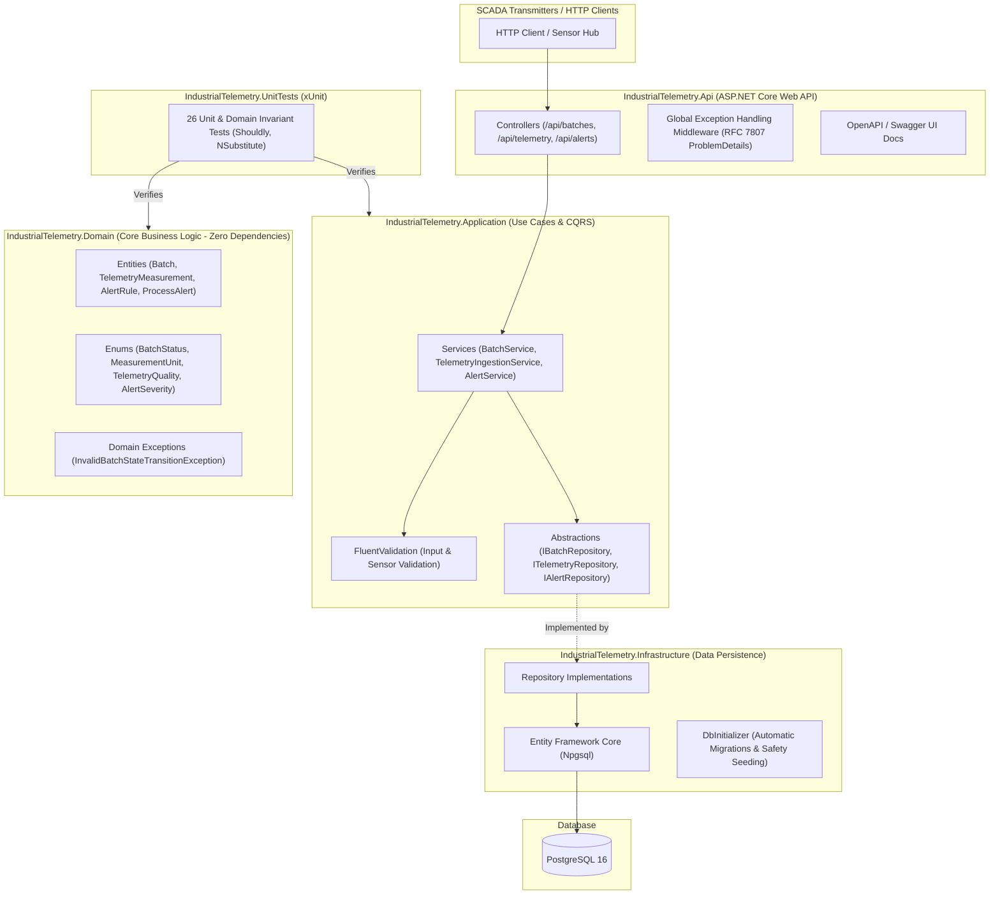

# 🏭 IndustrialTelemetry.Engine

[](https://github.com/yancsalmeida/IndustrialTelemetry.Engine/actions/workflows/ci.yml)
[](https://dotnet.microsoft.com/)
[](https://www.postgresql.org/)
[](https://www.docker.com/)
[](https://opensource.org/licenses/MIT)

An enterprise-grade **Industrial Telemetry, Batch Execution & Safety Alarm Management Web API** built with **C# (.NET 8)**, **PostgreSQL**, and strict **Clean Architecture**.

Designed for high-throughput sensor telemetry ingestion in batch manufacturing environments (chemical reactors, semiconductor cleanrooms, pharmaceutical synthesis, and food & beverage), bridging chemical engineering process automation with cloud-native backend software engineering.

---

## 🏗️ Architecture (Clean Architecture & DDD)

The solution is partitioned into modular layers adhering to strict **Dependency Inversion** and **Separation of Concerns**:



---

## ⚡ Key Capabilities

1. **Batch Lifecycle & State Machine:**
   - Strict transition rules (`Scheduled` $\rightarrow$ `InProgress` $\rightarrow$ `Completed` or `Aborted`).
   - Abort operations require mandatory operator rationale for regulatory auditing.
2. **High-Throughput Telemetry Ingestion:**
   - Ingests batch measurements across sensors (`TT-101` temperature, `PT-101` pressure, `pH-101`, `RPM-101`).
   - Validates physical measurement units and telemetry quality indicators.
3. **Automated Safety Alarm Evaluation:**
   - Incoming measurements are evaluated against active high/low safety thresholds in real-time.
   - Immediate generation of auditable `ProcessAlert` records with severity levels (`Info`, `Warning`, `Critical`).
4. **Historical Analytics & KPI Summaries:**
   - Aggregates sensor statistics (average, minimum, peak values, run durations) per batch run.
5. **Robust Database Design:**
   - Composite indexes on `(batch_id, timestamp_utc)` and `(batch_id, sensor_tag)` for optimal time-series range query performance.

---

## 🛠️ Technology Stack

| Layer | Technologies |
| :--- | :--- |
| **Runtime & Framework** | .NET 8 (C# 12), ASP.NET Core Web API |
| **Architecture** | Clean Architecture, Domain-Driven Design (DDD) |
| **Database & ORM** | PostgreSQL 16, Entity Framework Core (Npgsql), Code-First Fluent API |
| **Validation** | FluentValidation |
| **Logging** | Serilog (Structured JSON Logging to Console & Diagnostics) |
| **Documentation** | Swagger / OpenAPI UI served directly at root `/` |
| **Testing** | xUnit, Shouldly, NSubstitute (26 automated tests) |
| **Containerization** | Multi-stage Dockerfile, Docker Compose |
| **CI/CD** | GitHub Actions Automated Test & Build Pipeline |

---

## 📋 REST API Specification

### Batches (`/api/batches`)
| Method | Endpoint | Description |
| :--- | :--- | :--- |
| `POST` | `/api/batches` | Create and schedule a new manufacturing batch |
| `GET` | `/api/batches` | List batches with optional status filtering (`?status=InProgress`) |
| `GET` | `/api/batches/{id}` | Retrieve batch details and metadata |
| `POST` | `/api/batches/{id}/start` | Transition batch from `Scheduled` to `InProgress` |
| `POST` | `/api/batches/{id}/complete` | Mark active batch run as successfully `Completed` |
| `POST` | `/api/batches/{id}/abort` | Emergency abort batch with compliance reason |
| `GET` | `/api/batches/{id}/summary` | Retrieve batch KPI analytics (duration, averages, peak values) |

### Telemetry (`/api/telemetry`)
| Method | Endpoint | Description |
| :--- | :--- | :--- |
| `POST` | `/api/telemetry/ingest` | High-throughput sensor ingestion + automated threshold alert evaluation |
| `GET` | `/api/telemetry/batch/{batchId}` | Query chronological time-series measurements (`?sensorTag=TT-101`) |

### Safety Alerts (`/api/alerts`)
| Method | Endpoint | Description |
| :--- | :--- | :--- |
| `GET` | `/api/alerts/rules` | List active process safety and alarm rules |
| `POST` | `/api/alerts/rules` | Register a new threshold rule for a sensor tag |
| `GET` | `/api/alerts/batch/{batchId}` | List triggered alerts for a specific batch |
| `POST` | `/api/alerts/{id}/acknowledge` | Acknowledge an alarm with operator ID |

---

## 🚀 Quickstart & Execution

### 1. Run via Docker Compose (Recommended)

Start the entire environment (PostgreSQL 16 + ASP.NET Core API) with a single command:

```bash
docker compose up -d --build
```

- **Interactive Swagger UI:** Navigate to `http://localhost:5100`
- **Healthcheck:** `curl http://localhost:5100/health`

### 2. Run Locally via .NET CLI

Ensure a local PostgreSQL instance is running on port 5432:

```bash
# Clone the repository
git clone https://github.com/yancsalmeida/IndustrialTelemetry.Engine.git
cd IndustrialTelemetry.Engine

# Restore & Build
dotnet restore
dotnet build

# Run API
dotnet run --project src/IndustrialTelemetry.Api
```

---

## 🧪 Automated Testing

Execute the comprehensive unit test suite:

```bash
dotnet test
```

```text
Passed! - Failed: 0, Passed: 26, Skipped: 0, Total: 26, Duration: 113 ms
```

---

## 👤 Author

**Yan Almeida**  
- B.Sc. Chemical Engineering (Budapest University of Technology and Economics — BME)  
- Software Engineering & Systems Development (ISPGAYA — TPSI)  
- LinkedIn: [linkedin.com/in/yan-almeida](https://www.linkedin.com/in/yan-almeida)  
- GitHub: [github.com/yancsalmeida](https://github.com/yancsalmeida)
